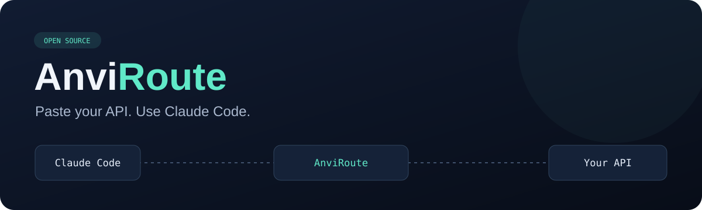
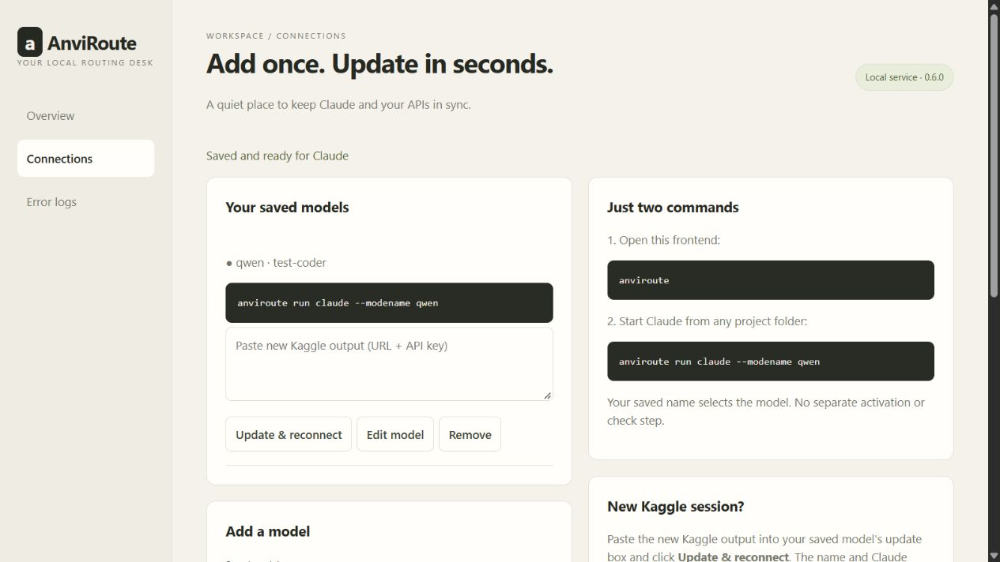
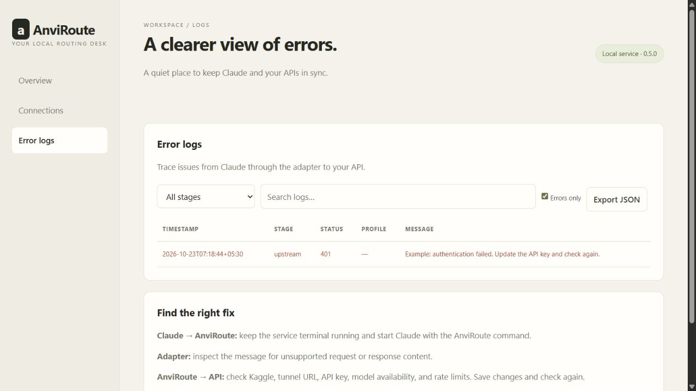

<p align="center"></p>

<p align="center">
  <a href="https://github.com/RaghavSharma006/anviroute/actions/workflows/ci.yml"></a>
  
  
  <a href="LICENSE"></a>
</p>

<h1 align="center">AnviRoute</h1>
<p align="center"><strong>Your Kaggle model. Your Claude Code. One command.</strong></p>

Two commands. One saved model name.

**1. Open the frontend:**

```cmd
anviroute
```

Name your model (for example `qwen`), enter the API URL and key in separate fields, and click **Save & connect**. AnviRoute detects the model, and checks the connection automatically.

**2. From any project folder:**

```cmd
anviroute run claude --modename qwen
```

**Kaggle restarted?** Enter the new URL and key in the saved model and click **Save & reconnect**. Keep the same name and Claude command. No separate activation or manual check step. Existing named routes use the updated address on the next request.

Windows encrypts saved API keys for your account. Other platforms keep keys in memory only.



<p align="center">
  <a href="https://github.com/RaghavSharma006/anviroute/releases/latest/download/AnviRoute.cmd"><strong>⬇ Download AnviRoute.cmd · about 32 KB</strong></a>
  &nbsp;·&nbsp;
  <a href="examples/kaggle_anviroute.ipynb">Kaggle setup notebook</a>
  &nbsp;·&nbsp;
  <a href="https://github.com/RaghavSharma006/anviroute/releases">All releases</a>
</p>

## What it does

AnviRoute is a small local API adapter. Your model runs on Kaggle (or another OpenAI-compatible server); Claude Code reads files, edits code, and runs approved commands on your computer.

```text
Your project → Claude Code → AnviRoute on your PC → your API URL → Ollama on Kaggle
```

**Release status:** alpha. Automated tests cover the local adapter, launcher, and Kaggle proxy against simulated APIs. A real Kaggle inference session has not yet been verified for this release. Model/tool compatibility varies; complete the [live test](docs/LIVE_TEST.md) before relying on it.

## 1. Download and open

**[Download AnviRoute.cmd](https://github.com/RaghavSharma006/anviroute/releases/latest/download/AnviRoute.cmd)** → **open it** → add your connection in the dashboard.

That is the entire setup. The single file installs itself and starts the local dashboard service. No ZIP extraction, separate installer, pip, dependency downloads, or private Python environment.

**Requirements:** your existing **[Python 3.10+](https://www.python.org/downloads/windows/)** and **[Claude Code](https://code.claude.com/docs/en/overview)**. The tiny download does not bundle either runtime. If Python is not installed yet, enable **Add Python to PATH** during its installation.

| Footprint | Size |
| --- | --- |
| Single downloadable command | About **32 KB** |
| Installed compressed application | About **21 KB** |
| Third-party runtime dependencies | **None** |
| Extra Python environments / pip installs | **None** |

Sizes exclude the Python and Claude Code installations you already have. The application uses Python's standard library; this is a disk/download measurement, not a RAM usage claim.

On first open, AnviRoute copies its tiny application into `%LOCALAPPDATA%\AnviRoute` and adds the command to your user PATH. It then starts immediately. You can delete the downloaded file after that.

For later use, reopen your terminal in **your project folder** and run:

```cmd
anviroute run claude --modename qwen
```

That command works from any folder. If using VS Code's terminal, restart VS Code once after initial setup so it receives the updated PATH. Updating is equally simple: download and open the new file.

Upgrading from v0.2? Its old `%LOCALAPPDATA%\AnviRoute\runtime` environment may remain on disk. The new launcher does not use it; it can be removed manually after verifying the new version works.

## 2. Start your Kaggle API

If you already have an API URL and bearer key, skip to [Independent startup](#3-independent-startup).

Otherwise, create a Kaggle Python notebook, enable **Internet**, choose a suitable GPU, and run the **two cells below in order**. You can also import [kaggle_anviroute.ipynb](examples/kaggle_anviroute.ipynb), which contains exactly these cells.

The example uses your selected model:

```text
orcarouter/Qwen3.8-27B-Uncensored:q4_K_M
```

The model's [Ollama listing](https://ollama.com/orcarouter/Qwen3.8-27B-Uncensored:q4_K_M) reports approximately **18 GB of weights**, before context/KV-cache memory. A 16 GB GPU may require CPU offloading and be slow; two GPUs are not automatically a single memory pool. Pick a smaller model if your available hardware cannot run it. Changing models means changing `MODEL` in **both cells**.

### Cell 1 — install Ollama and load the model

This installs required Linux packages, starts Ollama if needed, and downloads the model only if missing. The first download can take several minutes. Keep the notebook private; its second cell prints a live credential.

<details>
<summary><strong>Expand and copy cell 1</strong></summary>

```python
"""Kaggle cell 1: install Ollama, start it, and pull the selected model."""

import os
import time
import shutil
import subprocess
import requests

MODEL = "orcarouter/Qwen3.8-27B-Uncensored:q4_K_M"
# 32K is a memory compromise; larger projects may need 64K+ and more VRAM.
CONTEXT_LENGTH = 32768
OLLAMA = "http://127.0.0.1:11434"
WORK = "/tmp/rea"
os.makedirs(WORK, exist_ok=True)


def quiet(cmd):
    subprocess.run(cmd, check=True, stdout=subprocess.DEVNULL, stderr=subprocess.DEVNULL)


if not shutil.which("ollama"):
    quiet(["apt-get", "update", "-qq"])
    quiet(["apt-get", "install", "-y", "-qq", "curl", "zstd"])
    quiet(["sh", "-c", "curl -fsSL https://ollama.com/install.sh | sh"])
else:
    quiet(["apt-get", "install", "-y", "-qq", "zstd"])

# Keep the model API local; the second cell adds authentication before exposing it.
# Re-running this cell applies settings to the Ollama process this notebook owns.
previous_ollama = globals().get("ollama_proc")
if isinstance(previous_ollama, subprocess.Popen) and previous_ollama.poll() is None:
    previous_ollama.terminate()
    previous_ollama.wait(timeout=30)
try:
    requests.get(OLLAMA + "/api/tags", timeout=3).raise_for_status()
except requests.RequestException:
    with open(WORK + "/ollama.log", "a") as log:
        ollama_proc = subprocess.Popen(
            ["ollama", "serve"], stdout=log, stderr=subprocess.STDOUT,
            start_new_session=True, env={**os.environ, "OLLAMA_HOST": "127.0.0.1:11434",
                "OLLAMA_KEEP_ALIVE": "30m", "OLLAMA_NUM_PARALLEL": "1",
                "OLLAMA_MAX_LOADED_MODELS": "1", "OLLAMA_CONTEXT_LENGTH": str(CONTEXT_LENGTH)},
        )
    ollama_ready = False
    for _ in range(60):
        time.sleep(2)
        try:
            requests.get(OLLAMA + "/api/tags", timeout=3).raise_for_status()
            ollama_ready = True
            break
        except requests.RequestException:
            if ollama_proc.poll() is not None:
                break
    if not ollama_ready:
        raise RuntimeError("Ollama failed to start; check /tmp/rea/ollama.log")

response = requests.get(OLLAMA + "/api/tags", timeout=15)
response.raise_for_status()
models = response.json()["models"]
if not any(m.get("name") == MODEL or m.get("model") == MODEL for m in models):
    print("Downloading model quietly; this can take several minutes...", flush=True)
    quiet(["ollama", "pull", MODEL])

# Warm the model locally before the tunnel is used; report actual placement.
warm = requests.post(OLLAMA + "/api/generate", json={
    "model": MODEL, "keep_alive": "30m", "stream": False,
    "options": {"num_ctx": CONTEXT_LENGTH},
}, timeout=(10, 600))
warm.raise_for_status()
print("Loaded model / CPU-GPU placement:")
subprocess.run(["ollama", "ps"], check=True)
print("Context requested:", CONTEXT_LENGTH)
print("If Ollama was already running, restart the Kaggle session to apply server settings.")
print("✅ Ollama ready")
print("✅ Model:", MODEL)
```

</details>

### Cell 2 — protect the API and open Cloudflare

This creates a bearer API key, starts an inference-only proxy on port 11435, and opens a Cloudflare Quick Tunnel. It verifies the model list before printing the connection details. Rerunning the cell reuses the token within the same Kaggle session and replaces only its own recorded proxy/tunnel processes.

<details>
<summary><strong>Expand and copy cell 2</strong></summary>

```python
"""Kaggle cell 2: authenticated inference proxy + a Cloudflare Quick Tunnel."""

import os
import sys
import time
import re
import signal
import secrets
import subprocess
import requests

WORK = "/tmp/rea"
os.makedirs(WORK, exist_ok=True)
MODEL = "orcarouter/Qwen3.8-27B-Uncensored:q4_K_M"
CF = "/usr/local/bin/cloudflared"

subprocess.run(
    [sys.executable, "-m", "pip", "install", "-q", "flask", "requests"],
    check=True, stdout=subprocess.DEVNULL, stderr=subprocess.DEVNULL,
)

token_file = WORK + "/token"
if os.path.exists(token_file):
    with open(token_file) as stored:
        API_KEY = stored.read().strip()
else:
    API_KEY = secrets.token_urlsafe(32)
    descriptor = os.open(token_file, os.O_WRONLY | os.O_CREAT | os.O_EXCL, 0o600)
    with os.fdopen(descriptor, "w") as stored:
        stored.write(API_KEY)
os.chmod(token_file, 0o600)


def stop_previous(name, expected_command):
    # Only stop this notebook's recorded process, never arbitrary port owners/tunnels.
    path = WORK + "/" + name + ".pid"
    try:
        with open(path) as stored:
            pid = int(stored.read())
        with open(f"/proc/{pid}/cmdline", "rb") as process:
            command = process.read().replace(b"\0", b" ").decode(errors="replace")
        if expected_command in command:
            os.kill(pid, signal.SIGTERM)
    except (OSError, ValueError):
        pass


# Also supports upgrading older cells that did not write PID files.
for process_name in ("proxy_proc", "tunnel_proc"):
    previous = globals().get(process_name)
    if isinstance(previous, subprocess.Popen) and previous.poll() is None:
        previous.terminate()
        previous.wait(timeout=30)
stop_previous("proxy", WORK + "/proxy.py")
stop_previous("tunnel", CF + " tunnel")
time.sleep(2)

proxy_code = r'''
import hmac
import os
import requests
from flask import Flask, request, Response, jsonify

app = Flask(__name__)
app.config["MAX_CONTENT_LENGTH"] = 16 * 1024 * 1024
with open("/tmp/rea/token") as stored:
    TOKEN = stored.read().strip()
MODEL = os.environ["ANVIROUTE_MODEL"]
ALLOWED = {
    ("GET", "v1/models"), ("GET", "api/tags"), ("GET", "api/version"),
    ("POST", "v1/chat/completions"), ("POST", "v1/messages"),
    ("POST", "v1/messages/count_tokens"),
}

@app.route("/", defaults={"path": ""}, methods=["GET", "POST", "PUT", "PATCH", "DELETE"])
@app.route("/<path:path>", methods=["GET", "POST", "PUT", "PATCH", "DELETE"])
def forward(path):
    supplied = request.headers.get("Authorization", "").removeprefix("Bearer ")
    if not supplied.isascii() or not hmac.compare_digest(supplied, TOKEN):
        return jsonify({"error": "Unauthorized"}), 401
    if (request.method, path) not in ALLOWED:
        return jsonify({"error": "Unsupported inference route"}), 404
    try:
        # Regular JSON, never SSE over the random Cloudflare tunnel.
        payload = None
        if request.method == "POST":
            payload = request.get_json()
            if not isinstance(payload, dict):
                return jsonify({"error": "Expected JSON object"}), 400
            payload["model"] = MODEL
            payload["stream"] = False
        with requests.request(
            request.method, "http://127.0.0.1:11434/" + path,
            params=request.args, json=payload,
            headers={"Content-Type": "application/json", "anthropic-version": "2023-06-01"},
            timeout=(10, 600),
        ) as upstream:
            if upstream.ok and path == "v1/models":
                data = upstream.json()
                data["data"] = [item for item in data.get("data", []) if item.get("id") == MODEL]
                return jsonify(data)
            return Response(upstream.content, status=upstream.status_code,
                            content_type=upstream.headers.get("Content-Type", "application/json"))
    except requests.RequestException:
        return jsonify({"error": "Ollama request failed; check /tmp/rea/ollama.log"}), 502

app.run(host="127.0.0.1", port=11435, threaded=True)
'''

with open(WORK + "/proxy.py", "w") as source:
    source.write(proxy_code)
with open(WORK + "/proxy.log", "w") as log:
    proxy_proc = subprocess.Popen(
        [sys.executable, WORK + "/proxy.py"], stdout=log, stderr=subprocess.STDOUT,
        start_new_session=True, env={**os.environ, "ANVIROUTE_MODEL": MODEL},
    )
with open(WORK + "/proxy.pid", "w") as stored:
    stored.write(str(proxy_proc.pid))

proxy_ready = False
for _ in range(20):
    time.sleep(1)
    if proxy_proc.poll() is not None:
        break
    try:
        unauthorized = requests.get("http://127.0.0.1:11435/v1/models", timeout=3)
        authorized = requests.get("http://127.0.0.1:11435/v1/models",
                                  headers={"Authorization": "Bearer " + API_KEY}, timeout=10)
        if unauthorized.status_code == 401 and authorized.ok and authorized.json().get("data"):
            proxy_ready = True
            break
    except requests.RequestException:
        pass
if not proxy_ready:
    raise RuntimeError("Proxy startup/model check failed; inspect /tmp/rea/proxy.log and ollama list")

if not os.path.exists(CF):
    download = requests.get(
        "https://github.com/cloudflare/cloudflared/releases/latest/download/cloudflared-linux-amd64",
        timeout=60,
    )
    download.raise_for_status()
    with open(CF, "wb") as binary:
        binary.write(download.content)
    os.chmod(CF, 0o755)

with open(WORK + "/tunnel.log", "w") as log:
    tunnel_proc = subprocess.Popen(
        [CF, "tunnel", "--no-autoupdate", "--protocol", "http2", "--url", "http://127.0.0.1:11435"],
        stdout=log, stderr=subprocess.STDOUT, start_new_session=True,
    )
with open(WORK + "/tunnel.pid", "w") as stored:
    stored.write(str(tunnel_proc.pid))

PUBLIC_URL = None
for _ in range(60):
    time.sleep(2)
    with open(WORK + "/tunnel.log", errors="ignore") as log:
        urls = re.findall(r"https://[a-z0-9-]+\.trycloudflare\.com", log.read())
    if urls:
        PUBLIC_URL = urls[-1]
        break
    if tunnel_proc.poll() is not None:
        break
if not PUBLIC_URL:
    raise RuntimeError("Cloudflare failed; inspect /tmp/rea/tunnel.log")

for _ in range(30):
    try:
        response = requests.get(PUBLIC_URL + "/v1/models",
                                headers={"Authorization": "Bearer " + API_KEY}, timeout=5)
        if response.ok and response.json().get("data"):
            break
    except (requests.RequestException, ValueError):
        pass
    time.sleep(2)
else:
    raise RuntimeError("Tunnel URL assigned but not reachable; inspect /tmp/rea/tunnel.log and rerun cell 2")

print("✅ Proxy and tunnel ready")
print("Base URL:", PUBLIC_URL + "/v1")
print("Model:", MODEL)
print("API key:", API_KEY)
print("Keep this Kaggle session running. Keep the API key and these outputs private.")
```

</details>

Wait for:

```text
✅ Proxy and tunnel ready
Base URL: https://your-session.trycloudflare.com/v1
Model: orcarouter/Qwen3.8-27B-Uncensored:q4_K_M
API key: <your generated secret>
```

Copy **Base URL** and **API key**. Keep Kaggle running. Do not publish the notebook outputs, token file, or API key. The generated scripts/logs are in `/tmp/rea`; errors can be inspected in `/tmp/rea/ollama.log`, `proxy.log`, or `tunnel.log`.

## 3. Independent startup

`anviroute` starts a background service and returns immediately. You can close its terminal. It opens **http://127.0.0.1:20128** with the model setup form. Enter a saved name, API URL, and API key; **Save & connect** handles model detection and inference checks together.

From any terminal, run `anviroute run claude --modename qwen` from your project. Replace `qwen` with your saved name. If AnviRoute is stopped, the Claude command starts it automatically. Closing Claude leaves AnviRoute running; reopening Claude reuses the same service and saved connection. Each named Claude session keeps its own route even when another saved model is selected in the dashboard.

When Kaggle regenerates the URL/key, enter the new URL and key in the saved model and click **Save & reconnect**. No need to recreate the model or change the Claude command. Keep your Kaggle notebook private because its output includes a credential. AnviRoute cannot discover a random tunnel URL without receiving the new address.

Opening `anviroute` again reuses the running router and opens the frontend. Windows credentials restore after restart. Other platforms require entering the key again.

### Error logs and design

The **Error logs** page offers stage filters, message search, an errors-only view, and JSON export. Logs survive restarts, retain up to 500 visible events, and rotate at approximately 768 KB total. Prompts, replies, and credentials are excluded.



The ivory, charcoal, and olive console follows our [editable Canva design reference](https://canva.link/fz09319do9daxlp). The app uses local HTML/CSS/JavaScript with no UI libraries or external fonts.

## How credentials and replies work

- Named profiles save the URL, model, and format. Windows saves the key encrypted with DPAPI; the dashboard never returns it. Other platforms keep keys in memory only.
- AnviRoute sends the upstream key as `Authorization: Bearer ...`; Claude gets a separate temporary local token.
- The local server binds to `127.0.0.1`. The Kaggle proxy exposes inference/model-list routes and refuses model administration routes.
- Cloudflare Quick Tunnels [do not support SSE](https://developers.cloudflare.com/tunnel/get-started/quick-tunnels/#limitations). AnviRoute requests a **complete JSON response**, then builds Claude's event stream locally. **Replies appear after upstream generation finishes**, rather than live token-by-token.
- The default upstream timeout is 110 seconds. Larger/slow models can exceed tunnel timeouts. Increasing AnviRoute's timeout cannot override Cloudflare's own limits.
- Basic chat, client-side tool calls/results, and image input on compatible models are supported. Hosted tools, document blocks, deferred tools, and every advanced Claude feature are not supported by the OpenAI adapter. OpenAI-mode token counting is approximate.

See [SECURITY.md](SECURITY.md) for trust boundaries and limitations. This adapter does not make a model more capable, change its content behavior, or bypass Kaggle quotas.

## Troubleshooting

| Problem | Fix |
| --- | --- |
| `'anviroute.cmd' is not recognized` | Open the downloaded `AnviRoute.cmd` once, reopen Command Prompt, and restart VS Code if needed. Check `%LOCALAPPDATA%\AnviRoute\bin\anviroute.cmd` exists. |
| Python is not found | Install Python 3.10+ with **Add Python to PATH**, then reopen your terminal. |
| Claude is not found | Install Claude Code and verify `claude --version`. |
| Key field is blank after saving | Keys are deliberately never returned to the browser. Leave blank to keep the saved key. |
| No models listed | Check the URL/key and that Ollama has loaded the model. The endpoint must expose `/v1/models`. |
| HTTP 401/403 | Copy the actual Kaggle API key; old/new sessions may have different keys. |
| Proxy failed to start | Inspect `/tmp/rea/proxy.log`. Stop an unrelated process manually if it owns port 11435. |
| HTML instead of JSON | Wrong URL, an expired tunnel, or browser-only access protection. |
| Out of memory / very slow | The 27B Q4 example is large; use appropriate hardware or a smaller tool-capable model. |
| HTTP 429 | Provider/tunnel rate limit; wait before retrying. |
| Still connects to OmniRoute | Check Claude settings for conflicting `ANTHROPIC_BASE_URL`, provider flags, or `apiKeyHelper`. AnviRoute does not edit existing settings. |

## Other platforms

Install from source with `python -m pip install .`, then use the same two commands. The single-download installer is for Windows.

## Development and contributing

```sh
python -m pip install -e .
python -m pip install -r requirements-dev.txt
python -m unittest discover -s tests -v
python scripts/build_docs.py
python scripts/smoke_claude.py
```

Tests cover saved-profile restart, encrypted credentials, log redaction, launcher attachment, translation, tools/results, local authentication, and proxy restrictions. CI also tests Windows installation and invoking the command from another directory. Live compatibility is recorded separately through [docs/LIVE_TEST.md](docs/LIVE_TEST.md).

Contributions, reproducible bug reports, and tested model reports are welcome. See [CONTRIBUTING.md](CONTRIBUTING.md). If this saves you setup time, a star helps others find it.

Independent community project. Not affiliated with Anthropic, Ollama, Kaggle, or Cloudflare. Non-Claude models in Claude Code are outside Anthropic's official support. [MIT license](LICENSE).


## Connection checks and performance

Use **Send test message** on a saved model to see a real reply, elapsed time and input/output tokens. Each Claude launch rechecks the model endpoint; failed requests invalidate readiness. Error logs include duration and tool counts, never prompt text. Pasting an API key with a `Bearer ` prefix is accepted.

The notebook warms the model, keeps it loaded for 30 minutes, and configures one inference slot with a 32K context. Existing Ollama processes must restart for server settings to apply. Check `ollama ps`: CPU offloading is a common cause of slow inference. A 27B model plus context may exceed your GPU memory. Increase context only when memory allows; Ollama recommends 64K+ for larger Claude projects. AnviRoute does not silently truncate your conversation or tools; OpenAI token counting is an estimate.

Quick Tunnels do not support SSE, so replies are buffered until generation finishes. Keeping the model warm cannot extend Kaggle session limits or revive a stopped notebook. After shutdown, rerun the cells and enter the fresh URL and key in the same saved profile. No key or URL can repair an offline backend.

References: [Ollama memory and concurrency](https://docs.ollama.com/faq), [Claude context guidance](https://docs.ollama.com/integrations/claude-code), [Quick Tunnel limitations](https://developers.cloudflare.com/tunnel/get-started/quick-tunnels/).

Set **Context window (tokens)** under the saved model’s optional settings to the context configured in Ollama (32768 with this notebook). AnviRoute passes it to Claude Code so compaction does not assume a 200K window for an unknown model. Leave blank only when Claude already knows the provider’s correct limit.


The combined output parser has been removed. Use the normal URL and password fields. Leave the key blank when editing to keep the saved key. Dark mode is the default; the theme toggle remembers your choice.

### Windows app-cache compatibility

Installation and service state live in `%USERPROFILE%\.anviroute`, shared by ordinary terminals and packaged desktop apps. Existing saved models and encrypted keys migrate on first use; service tokens are recreated. Reopen your terminal after updating so it picks up the current launcher on PATH.

Unspecified context windows default to **32,768 tokens**, including older profiles without a limit. Set the actual backend window in Edit model when different, and restart Claude for it to take effect. AnviRoute passes the context limit and a bounded output-token allowance at launch. The dashboard shows the saved limit, recent errors beside connections, and copy buttons beside commands.
